# Boids

This repository features the source code for a Computer Graphics assignment about Boids, illustrating each feature with images. In addition, an in-class presentation was performed to visually demonstrate the project's results. The code was written entirely in C++ and OpenGL, with shaders implemented in GLSL.


## What are boids?

Boids are simple simulated agents that reproduce flocking behavior using only local rules. Each boid follows three basic behaviors: separation (avoid crowding neighbors), alignment (match the average heading of nearby boids), and cohesion (steer toward the average position of nearby boids). From these simple, local rules, complex and natural-looking group motion emerges without any central control.


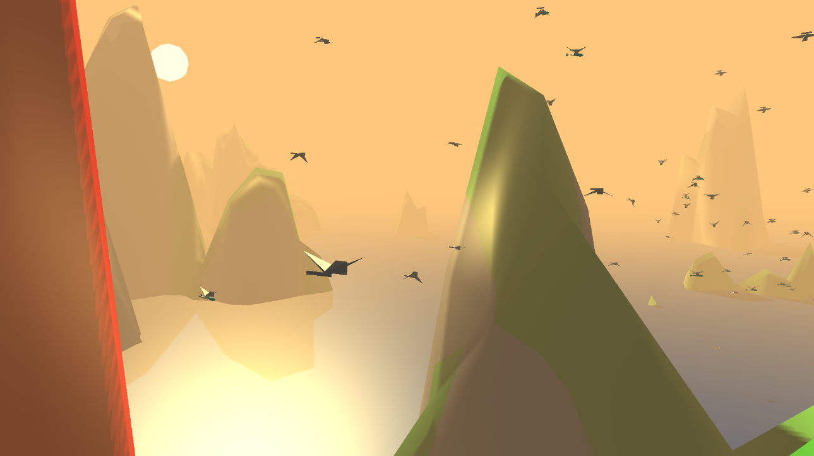

This project uses boids to simulate flocks of birds that interact and move together in a shared world, with the additional rule of moving towards a leader.

## Controlling the Scene

- **View modes (5 modes):**
You can change the view mode by pressing the `C` key. The modes are the following:

  1. Central view from the tower
  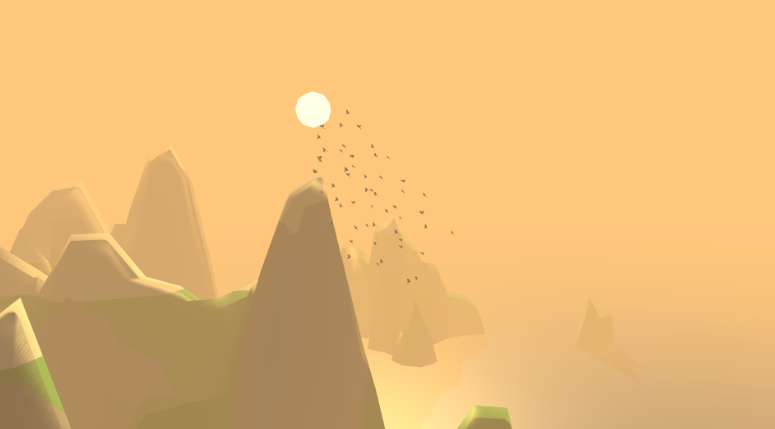
  2. View following the flock, from behind
  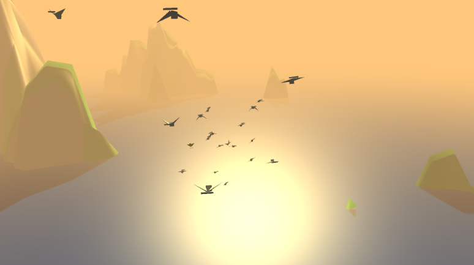
  3. View following the flock, parallel to the ground
  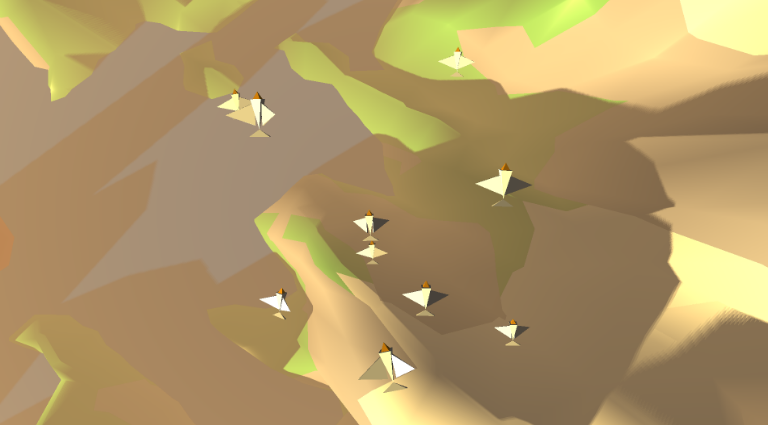
  4. First-person view of the last bird added to the scene
  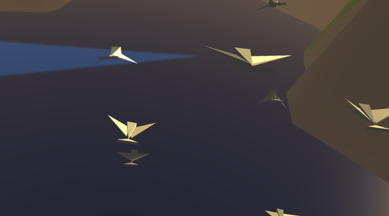
  5. Free camera, controled by the user using `WASD` and `ARROW` keys.
  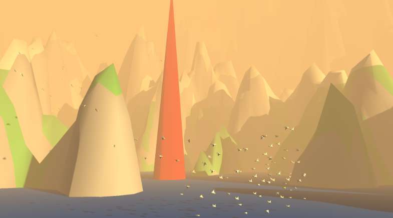

- **Adding and Removing Boids:** It is possible to add Boids by pressing `+`, and to remove them by pressing `-`.

    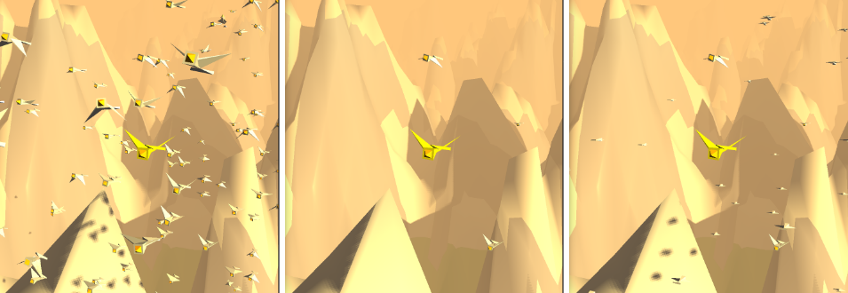

 - **Debug Mode:** The application includes a pause mode (`P`) and a debug mode (`D`) in which each boid's information is printed frame-by-frame. It is possible to add and remove boids and move the camera freely in both modes.

    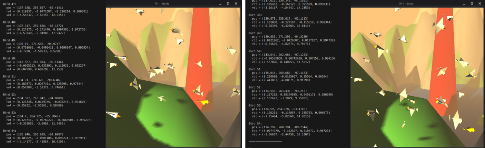

- **Wireframe Mode:** Togglable wireframe rendering highlights mesh topology for debugging and visualization of instanced geometry.

    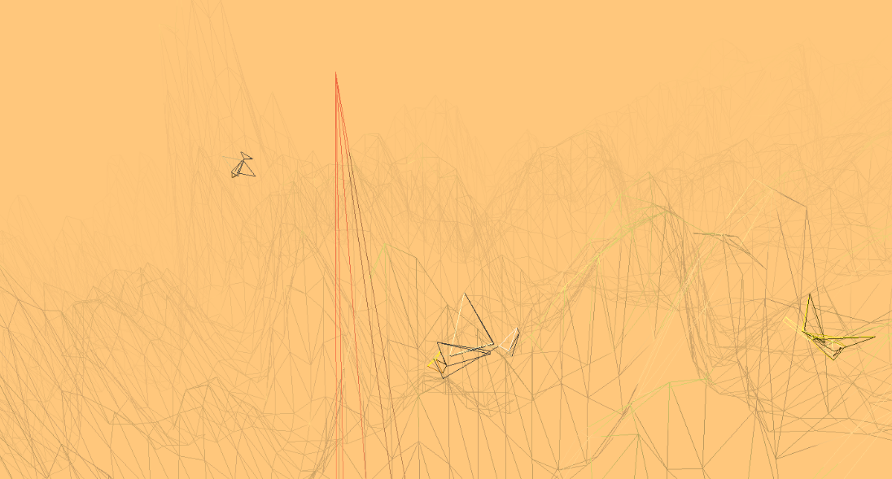

## CG Features

- **Ground (heightmap):** A ground generated from a heightmap, stretched vertically. It uses a shader that colors it as a mountain range with icy peaks.
  

  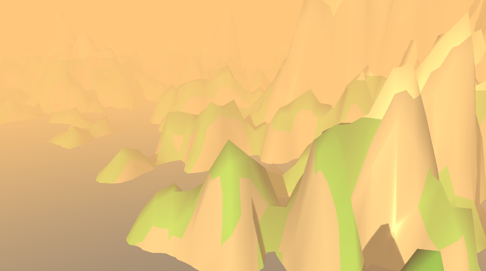

- **Mountains as obstacles:** The mountains act as obstacles; boids actively try to avoid colliding with them by temporarily overriding their flock behaviors. The leader is a "ghost", and is allowed to pass through them.

    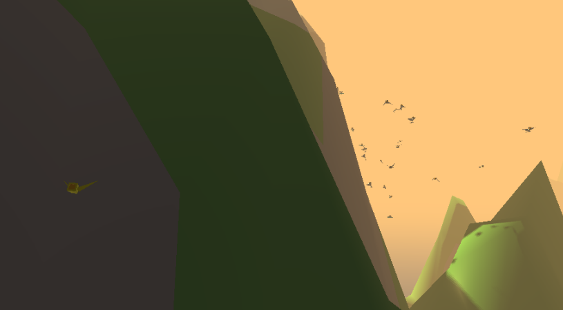

- **Sun (shader):** There is a Sun in the scene, rendered with a separate shader and aligned with the directional light source.

    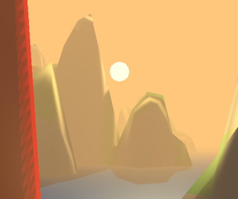

- **Blinn - Phong Model:** The world and the birds are lit using the Blinn-Phong model (Phong + gamma factor) and a directional light. In other words, there is ambient lighting, diffuse lighting, and smooth specular reflection.

    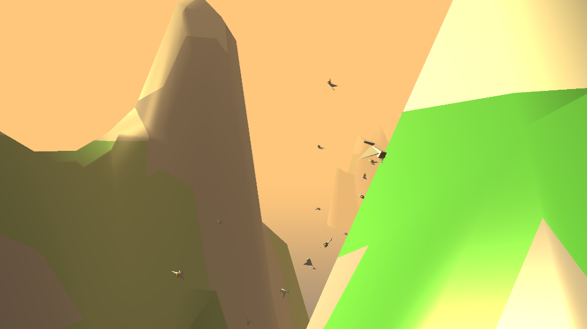

- **Directional shadows:** Shadows are implemented using shadow mapping for a directional light. The fragment shader samples a depth map (`uShadowMap`) and applies percentage-closer filtering (PCF) with a small bias to reduce shadow acne, producing softer shadow edges.
    
    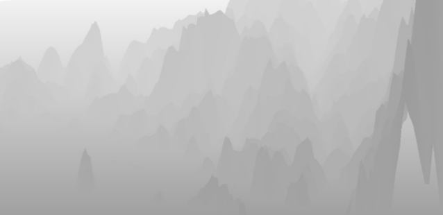
    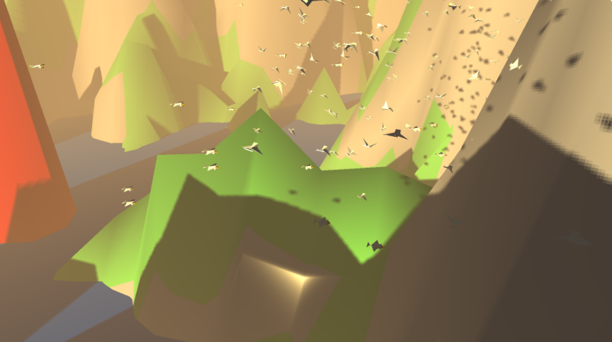

- **Fog:** Exponential fog is computed in the fragment shader using the uniforms `uFogColor` and `uFogDensity`. The fog factor is calculated from the distance between fragment and camera and blends the final color towards the fog color (e.g. `fogFactor = exp(-uFogDensity * dist)`).

    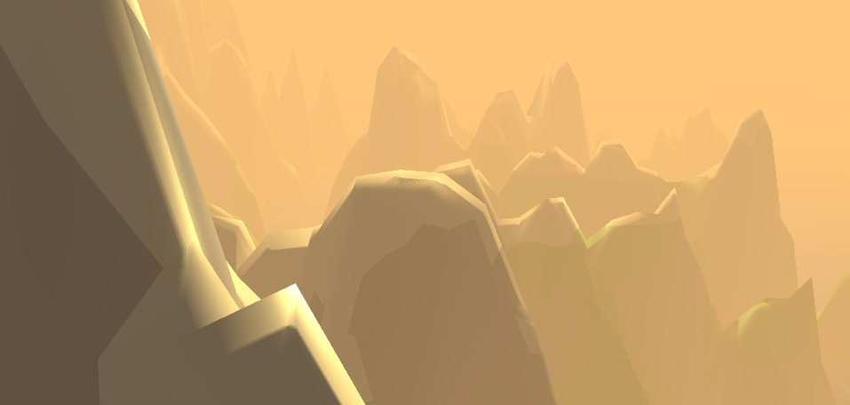

- **Banking:** Birds smoothly roll (bank) into turns: the model tilts laterally according to turning curvature and velocity to simulate aerodynamic banking, improving perceived realism during flock maneuvers.
    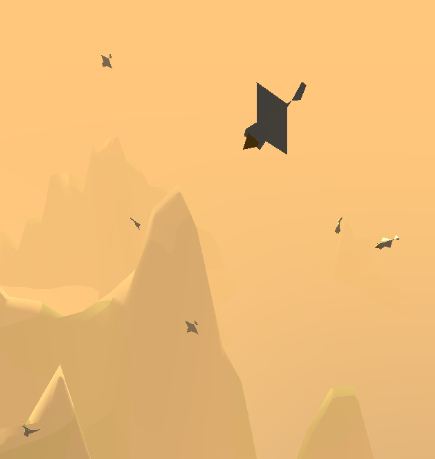

- **Dynamic Wingflap:** Each bird animates its wings dynamically based on its speed and state. Wingbeat frequency and amplitude adapt to flight velocity and maneuvers (faster, stronger flaps when accelerating; wings extend during dives), producing a more natural flock motion.
    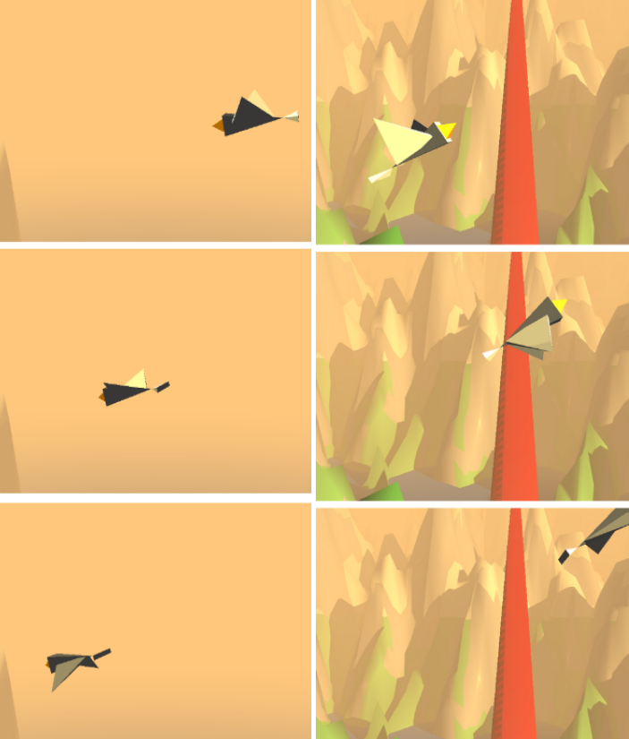


- **Diving animation:** When descending rapidly, birds extend their wings and orient them in the direction of the dive. This, combined with banking, creates more realistic movement, as if there is some air resistance.

  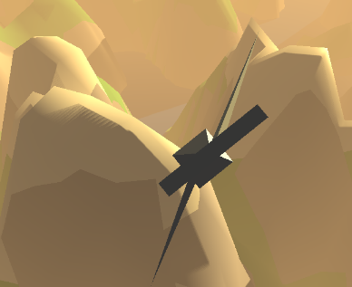


- **Birds fish:** Birds that dive into the sea return holding a fish.
    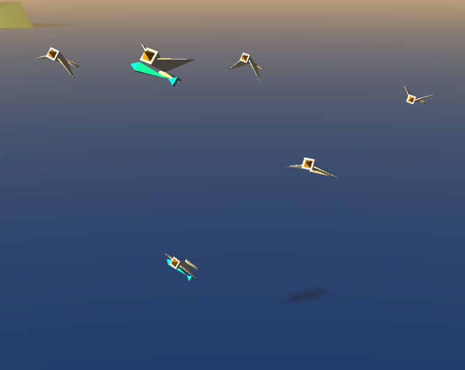

- **GPU Instancing:** Birds are drawn using `glDrawElementsInstanced()`, which makes it possible to render thousands of them in a single GPU pass. In other words, the program's main bottleneck is CPU time rather than the graphics pipeline.

    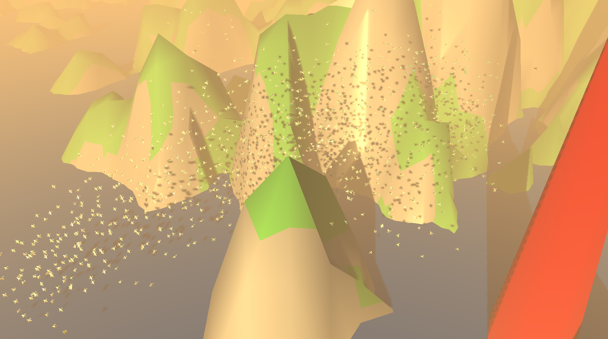

### Compiling and running
The compiling process requires make installed on a Linux environment. To compile, just type `make`:
```
make 
```

For compiling and running, just type `make run`:
```
make run
```

Feel free to edit the makefile or compile it in another way to better match your system settings.